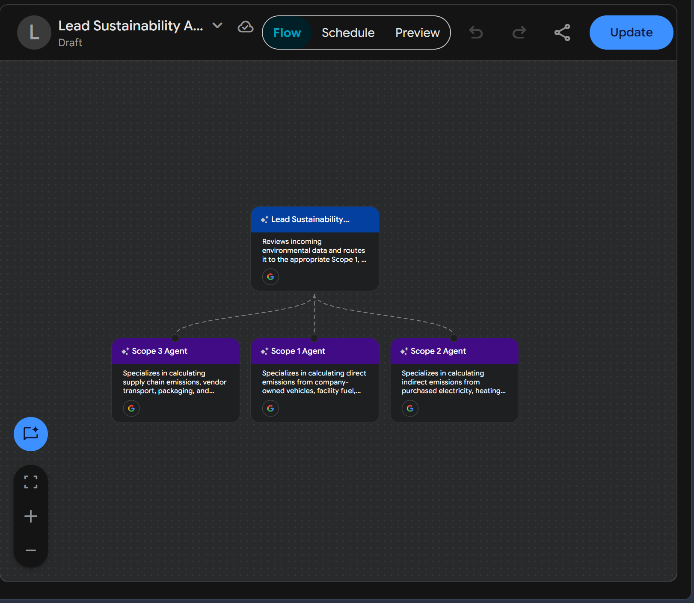

# 🌍 ESG Multi-Agent Sustainability Auditor

[](https://cloud.google.com/vertex-ai)
[](https://github.com/Downey112/esg-multiagent-auditor)
[](https://ghgprotocol.org/)



## Overview
The **ESG Multi-Agent Sustainability Auditor** is an automated, event-driven enterprise AI architecture designed to classify, route, and calculate corporate greenhouse gas (GHG) emissions. Built using the **Google Cloud Gemini Enterprise Agent Platform**, this system eliminates manual data triage by orchestrating a network of specialized AI agents that independently audit Scope 1, Scope 2, and Scope 3 environmental data.

By decentralizing the audit process into specialized domain sub-agents, this architecture delivers high fault tolerance, scalable data ingestion, and precise emission calculations compliant with standard GHG protocols.

---

## 🏗️ System Architecture

This project utilizes a **Router-Worker** multi-agent design pattern. An entry-point Lead Auditor handles intent recognition and securely routes unstructured records to domain-specific calculation agents.

| Agent Role | Domain Specialty | Primary Function |
| :--- | :--- | :--- |
| **Lead Sustainability Auditor** | Traffic Routing | Analyzes raw input (invoices, logs, bills) and routes context to the appropriate worker agent based on emission type. |
| **Scope 1 Agent** | Direct Emissions | Calculates $CO_2e$ from company-owned assets, facility boilers, and fleet fuel consumption. |
| **Scope 2 Agent** | Indirect Energy | Extracts kWh data from utility bills and applies regional eGRID emission factors to calculate purchased energy footprint. |
| **Scope 3 Agent** | Supply Chain & Travel | Evaluates complex supply chain logs, vendor transport, and employee business travel data. |

---

## 🚀 Key Enterprise Value
* **Automated Data Triage:** Replaces manual HR/Sustainability categorization by automatically parsing unstructured vendor invoices and utility bills.
* **Domain Specialization:** Each sub-agent is strictly bounded to its specific emission scope, preventing hallucinations and logic crossover between direct and indirect calculation formulas.
* **Auditability:** Maintains a clear routing log and calculation rationale for every transaction, ensuring compliance readiness for ESG reporting.

---

## 📁 Repository Structure
```text
esg-multiagent-auditor/
├── lead_router_prompt.md    # System prompt for the primary router
├── scope_agents_config.yaml # YAML configurations for the worker network
├── system_flow.png          # Architecture visual map
├── system_flow-1.png        # Workflow canvas preview
└── README.md                # Documentation
```

---

## 🛠️ Tech Stack
* **Orchestration:** Google Cloud Gemini Enterprise Agent Platform
* **LLM Engine:** Gemini 3.8 Flash
* **Design Pattern:** Multi-Agent Router-Worker Pattern
* **Protocol:** Greenhouse Gas (GHG) Protocol Corporate Standard
